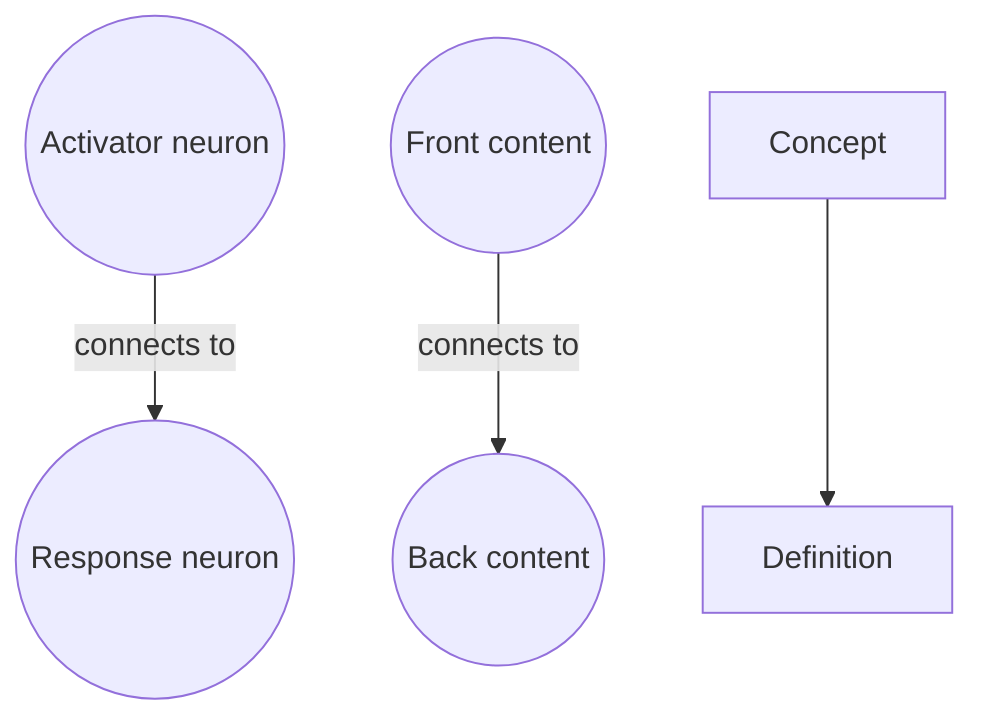
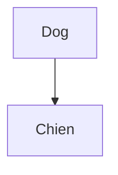
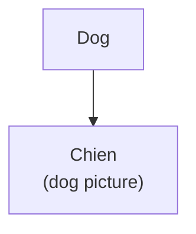
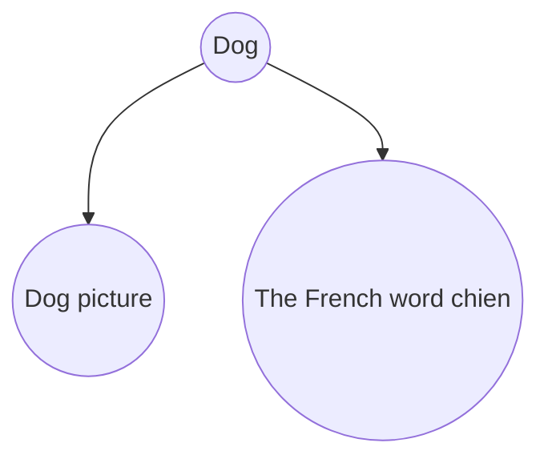
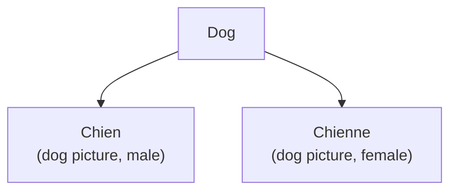
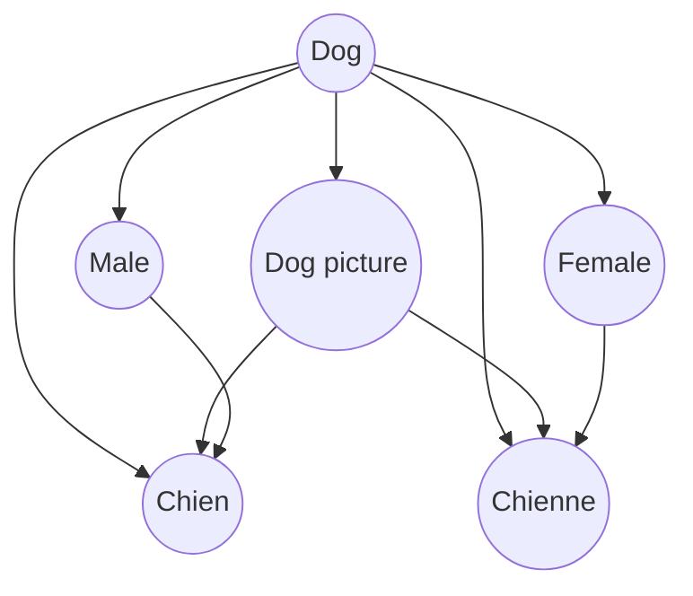
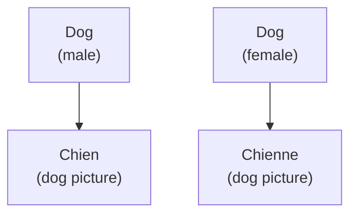
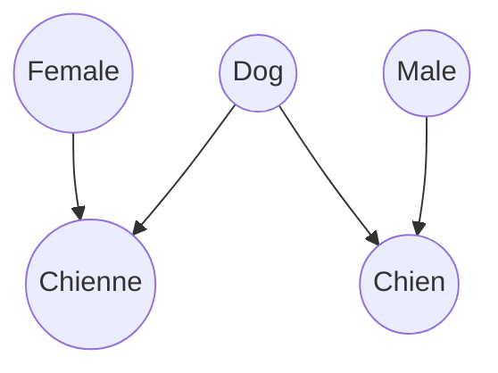

# Authoring Flashback cards

## Why Flashback cards look like this

Most knowledge for a specialized career or skill arrives in a language that differs from the language of the brain. That gap makes skill acquisition slow. The brain stores what it knows as a graph, and it reorganizes that graph all the time. Flashback stores knowledge as a graph too. A person can plan the connections between concepts and learn them in a form that the brain reads well.

Memorization alone does not make a skill. Knowing every recipe in a book does not make a chef. But knowledge and memory are tools that every skill needs, and a well-designed card makes retrieval from the brain faster. Each user is responsible for how they design that graph.

## The governing constraint

A card is a recurring task that you give a person for the next several years. Card design is task design. A badly written card does not cost one bad review. It lapses again and again, drags the scheduler, and makes the user resent the deck.

Everything below follows from one rule.

One card, one retrieval. If a correct answer needs two things that the user can forget separately, write two cards.

One retrieval means one chunk, not one token. A chunk can be several words long. Anyone who knows `tail` retrieves `tail -n 10 file.txt` as a single motion. A card breaks when it joins chunks that the user does not yet hold together, behind a single pass or fail grade.

This rule matters more in Flashback than in a generic spaced repetition app, for two reasons.

1. Memory. A simple item rests on one connection that each review refreshes. A complex item activates in parts, in an order that changes with context, so no review strengthens the whole item. This is Wozniak's minimum information principle.
2. Signal. Grading is pass or fail. A card with five facts gets one grade, so the review log cannot record which fact failed. The scheduler then schedules all five facts by the weakest one. Flashback plans to use retention data as a quality signal, so bundled cards also corrupt that measurement.

## Step 0: read the vault before you write

Do these steps in this order, every time.

1. Call list_categories to get the valid category names. The API rejects an unknown name.
2. Call list_cards with origin "human". The handmade cards define the style. Match their length, phrasing and cue conventions. Do not invent a house style.
3. Call list_decks to find the target deck. Note whether the user needs a new deck.
4. Call list_cards with sortBy "lapses" to find the cards that the user keeps failing. A card with many lapses almost always has a wording problem, not a memory problem. Offer to rewrite these cards. A rewrite often helps more than new cards.
5. To card a document, call list_highlights with uncardedOnly true, then read the body around each highlight.

### Highlights are the only material

The user's highlights say what matters, and they are the only material that you card. create_flashcard takes the highlightHash of one of them, and no tool can make a highlight. Read as much as you need for context. The paragraph before a highlight often decides what the card asks. A passage without a highlight is not a target.

When the user asks for cards on something without a highlight, such as "card this chapter", name the passages that you would card. Ask the user to highlight them in the app, and then card the highlights. This keeps every AI card on something that the user chose and checks.

Effort goes into quality cards, not into fast coverage. Suggest at most 20 new cards for one day. If the user insists, make more, but warn them about making more cards than they can review. Cramming does not help.

### Reading the body

read_document returns the content of Markdown, plain text, `.clip` and `.youtube` files, and the sidecar of every file. The sidecar holds the existing cards, tags and highlights. For a PDF, EPUB, image, audio or video file, read_document returns null content. In that case, call read_document_text with the same path. It extracts and pages the text on the server, by format:

- A PDF by page number.
- An EPUB by section number or href.
- A YouTube transcript by segment, or by `at` in seconds to jump to a moment.

Start with the path alone. Then follow `next` until `hasMore` is false. Follow `nextCharOffset` when a unit comes back cut short. Each response has a label, such as "p. 37" or a timestamp. Cite it when a card comes from a specific place.

### Pictures and sound

Text extraction returns prose only. A document's media comes from its own tools.

Use list_book_images for an EPUB. Use list_clip_media for a saved web clip, which also holds any short audio from the page. Both tools list the alt text, the caption and the section or heading of each item. That metadata usually tells you which figure is which. Use view_book_image or view_clip_image when it does not.

Put a picture or a sound on a card with attach_book_image or attach_clip_media. Do this for any illustrated source. A real diagram beats a description of one, as the section on activator cues shows. A pronunciation recording is the only honest front for a pronunciation card.

### Two limits

- A scanned PDF has no text layer, so it returns nothing.
- search_content searches only `.md` and `.txt` bodies. A miss there does not prove that the vault lacks a topic. Look at the highlights and the cards on the media documents too.

## The house style

The handmade cards show this style. Keep it.

- A front is a short task description or a question. "Initialize a git repository" and "What command creates a new repository in the current directory?" both work. Each card needs a specific context. Find out which form works best for the user.
- A concrete value goes in parentheses at the end of the front. "Git command to stage a file (readme.md)" has the answer `git add readme.md`. The parentheses pin the exact answer without a longer sentence.
- A type_answer answer is the bare artifact. Put no prose, explanation or parentheses in answerText. The app compares it character by character, so anything extra can fail a card that the user knew. An explanation for this card goes in backText, which the app shows after the check and never compares. An explanation that stands alone belongs on its own basic card.
- A symbol card is a pair that you cannot split further, such as あ and "a". This is the target shape. The further a card is from it, the more reason it needs.
- A context marker separates the same question in different contexts. "Get directory contents" has the answer `ls` in bash and `Get-ChildItem` in PowerShell. Start such a front with the context in brackets: "[bash] Get directory contents" and "[PowerShell] Get directory contents". The marker lets the user see the context without effort. Only cards that would be ambiguous, such as instruction sets or vague questions, need a marker.

## Choose targets, then write prompts

These are two separate jobs. Do them in order. Keep them apart. When you mix them, you write a prompt for whatever sentence you happen to read.

First, choose targets. Read the material and mark the pieces worth recalling. Skip what the user already knows, what follows trivially from it, and what the user never needs to recall cold. The highlights are the target list. A highlight can hold several targets, but nothing outside the highlights is a target.

Then write one or more prompts for each target. The method depends on the kind of knowledge: factual, procedural or conceptual. The `knowledge-types` reference section gives example patterns for each kind. It covers closed and open lists and the conceptual lenses: attributes, similarities and differences, parts and wholes, causes and effects, and significance.

For a set of more than about ten cards, show the user the target list before you draft. A target list is cheap to correct. Cards are not. Talk with the user about the mental model that the cards serve and about their purpose. For example, cards on single git commands improve when the user first settles the model of branches, the working tree, the staging area and merges.

## Card types

| Type | Use it for |
| --- | --- |
| `type_answer` | A short, exact artifact that the user types from memory, such as a command, an operator, a keyword, a kana or a signature fragment. The app grades `answerText`. `backText` holds optional notes that the app shows afterwards. |
| `basic` | Anything that the user grades by judgment, such as an explanation, a distinction, a reason, a tradeoff or a rule of thumb. |
| `cloze` | A target inside a structure, where the structure is part of the knowledge. Examples are a slot in a statement or an item in a closed list. Mark each blank with `{{double braces}}`. |
| `reversible` | A pair that you cannot split, such as a term and its symbol, or a word and its translation. Skip it when one direction is much easier than the other. |
| `custom` | Raw HTML, for a layout that carries meaning, such as a table or a positioned diagram. |

Use type_answer by default to produce an answer, and basic to explain one. A cloze card is fast to write and easy to remember, but the user can pass it by pattern matching. With a long or distinctive sentence, the user learns the shape of the sentence instead of the knowledge. Keep cloze sentences short and generic.

## Five properties to check before you save

- Focused: the card asks for one detail. Extra detail dulls attention and gives incomplete answers.
- Precise: the card says exactly what it asks for. A vague question gets a vague answer.
- Consistent: the card has the same answer every time. Otherwise it suppresses related knowledge that the user does not recall.
- Tractable: the user can answer it almost every time. If not, split it or add a cue.
- Effortful: the user must retrieve the answer, not infer it from the question.

Then apply two tests.

False positive: can the user give the answer without the knowledge? The user memorizes long questions with distinctive wording as shapes. A cue that leaves only one possible answer gives the answer away.

False negative: can the user know the answer and still fail? This test catches most broken syntax cards, and it has a clear sign. You add a hint, such as "using a range test", so that only your intended answer fits. That hint shows that the front asks for a task outcome while the target is a specific construct. Name the construct in the front instead. The section on several constructs below shows how.

## Syntax, command and code cards

Cards fail most often here, so this section gives explicit rules.

### The answer is one chunk, not one token

A production card builds motor memory for something that the user types. So the answer is a whole command that the user would really run, not a fragment. `tail -n 10 file.txt` and `Get-ChildItem -Recurse -Filter *.txt` are correct answers. Cutting them down to `-n` or `-Recurse` destroys what the card is for.

The unit is one chunk, a piece that the user holds as a single thought. A chunk can have several tokens. `rm -r build` is one chunk: the command, its usual flag and its argument, retrieved together. A card must not join independent chunks behind one grade.

The size of a chunk depends on the learner, not on the material. As the user gains fluency, three chunks become one, and the cards grow with them. Write each production card at the largest size that the user can retrieve in one motion now.

### Front length is the real constraint

These two real cards from a vault both have answers with several tokens. Only one works.

- It works, at level 4. The front is "[Bash] Show the last 10 lines of file.txt". The back is `tail -n 10 file.txt`.
- It stalls, at level 0. The front is "[SQL] Return all columns, matching each orders row to customers where orders.customer_id equals customers.id, keeping only rows that match in both tables". The back is `SELECT * FROM orders INNER JOIN customers ON orders.customer_id = customers.id;`.

The answers are similar. The fronts are not: 8 words against 26. The user must decode a long front before retrieval starts, and the decoding competes with recall. Keep a front to about a dozen words, phrased as a task, with concrete values in a compact form. Some cards need more, but this is the general rule.

### When several constructs fit the task, name the construct

A shell task usually has one idiomatic answer, so a plain task description is clear. Expressive languages differ. Both `BETWEEN` and `>= AND <=` select "rows where total is between 50 and 100". This is a property of the language, not a fault of the card. Put the construct in the front instead of adding a hint.

Follow the vault's convention: the construct and a compact list of parameters.

| Front | Back |
| --- | --- |
| `[SQL] BETWEEN filter on orders.total (50, 100)` | `SELECT * FROM orders WHERE total BETWEEN 50 AND 100;` |
| `[SQL] INNER JOIN orders to customers (orders.customer_id, customers.id), all columns` | `SELECT * FROM orders INNER JOIN customers ON orders.customer_id = customers.id;` |

The cards keep whole statements and motor memory. The fronts are a third as long, and the ambiguity is gone.

### When a whole statement is too big, add support cards

If the user keeps failing a card with a full statement, the parts of the statement are not yet mature. Add small cards for the weak parts beside the full card. The full card climbs as its parts grow stronger. Do not replace the full card with fragments. Fragments train recognition instead of production.

### Strip characters that carry no knowledge

Trailing semicolons, optional aliases, extra spaces and arbitrary letter case are all ways to fail a card that the user knew. Keep the answer to its canonical minimum. type_answer compares the typed value exactly, so this rule decides whether a deck is usable.

### Use one schema across a deck

When syntax cards need table and column names, use the same names on every card in the deck. Otherwise the user recalls arbitrary names beside the real knowledge, and each card carries its own vocabulary.

## Several activator cues

A flashcard copies a pair of neurons. Its two sides hold two pieces of information, the front and the back, as two neurons hold two concepts. Correct exposure to the card strengthens the connection between them, as the brain strengthens a connection in its graph.

The best cards have several activator and response neurons. Take a French learner who makes a card for the word "dog".

This card connects the word "dog" to the word "chien". It does not connect "chien" to the concept of a dog. A picture of a dog adds that connection.

The neuron map now looks like this.

One picture made a card with several connections. Now the word "dog" also recalls that French calls a dog "chien". But French has grammatical gender, which groups words into classes that change their form. A male dog is "chien" and a female dog is "chienne". A first attempt puts both on one card.

This card holds both concepts, but it is not efficient. The word "dog" now activates both "chien" and "chienne", which blurs the difference. The neuron map shows why.

A programmer sees the problem. This graph acts as a decision tree. To use the node "dog", the brain must test every branch to find the right word. Two cards fix it.

These are two cards with several activators each, one card for each concept. The neuron map is now this.

This graph is easier to traverse. Any activator neuron can be the front, and the graph has no extra connections. The word "dog" activates both "chien" and "chienne". The concept of a female dog fires the "female" and "dog" neurons, so "chienne" activates more strongly than "chien". Give each card as many activator neurons as you can.

## Categories

The priority of a category sets the review order: vocabulary first, then models, then production. So a category carries teaching weight. It is more than a label.

| Category | Priority | Use it for |
| --- | --- | --- |
| Definition, Symbol, Syntax, Terminology | 0 | Vocabulary that you cannot split: the meaning of a term, the reading of a glyph, the written form of a construct |
| Concept, Example | 1 | Why something works, distinctions and tradeoffs, and examples of use |
| Command, Exercise | 2 | A shell or tool command for a task, and an application with several steps |

Syntax is the written form of a language construct. Command is a tool invocation. Definition is what a word means. Concept is how or why something behaves.

The user can change the names and priorities of the categories, so they differ between vaults. Read the vault's own list with list_categories. If no category fits, ask the user before you call create_category. Nobody can delete a category, only rename it.

## Volume

Write more cards than feels natural. The urge to save cards is strong and wrong. The material fixes the amount of knowledge, so coarse cards do not reduce what the user must learn. They only make it harder to review. An easy card costs about 10 to 30 seconds over its whole first year.

The balance comes from selection, not from coarse cards. Do not card what the user already knows. Do not card everything for the sake of completeness. Delete a card that no longer serves a purpose.

## Mechanics and known problems

- The MCP server marks every card that it creates with origin "ai", and nothing can change that mark. The user audits where cards came from with it. Do not work around it.
- To put a card in a named deck, call add_to_deck after create_flashcard. If you forget this call, the deck stays empty.
- backText and answerText store HTML entities as plain text. If you write `&gt;`, the card stores those four characters, not `>`. Write the literal character. Then read the card back and fix it with update_flashcard if needed. In answerText this matters, because the app compares the typed value with the stored string.
- An old type_answer card looks as if it has no answer, but it has one. A card written before answerText existed reports null for it and keeps its graded answer in backText. Read null as the old shape, not as an empty card. Never overwrite backText on such a card unless you move its text into answerText in the same update_flashcard call. Otherwise you delete the answer.
- Every card has an anchor in its source. The path and the highlightHash, which create_flashcard both needs, tie the card to its highlighted passage. That anchor makes the vault a graph instead of a pile of cards. From these tools, you cannot make a card without a document or a highlight.
- update_flashcard takes the globalHash that create_flashcard returned, plus documentPath for an anchored card.

## Workflow

1. Read the vault, as Step 0 says.
2. Choose targets from the user's highlights without cards. For a set of more than about 10 cards, show the list before you draft. If the user asked for something without a highlight, stop and ask the user to highlight it.
3. Draft the cards. Check each card against the five properties and both tests.
4. Create each card with its highlight's path and highlightHash. Then call add_to_deck when the user wants a named deck. Do not skip this step.
5. Read a sample back to check how it renders, mainly cards with symbols or escape characters.
6. Report what you made. Name anything that you left out on purpose, and say why.
